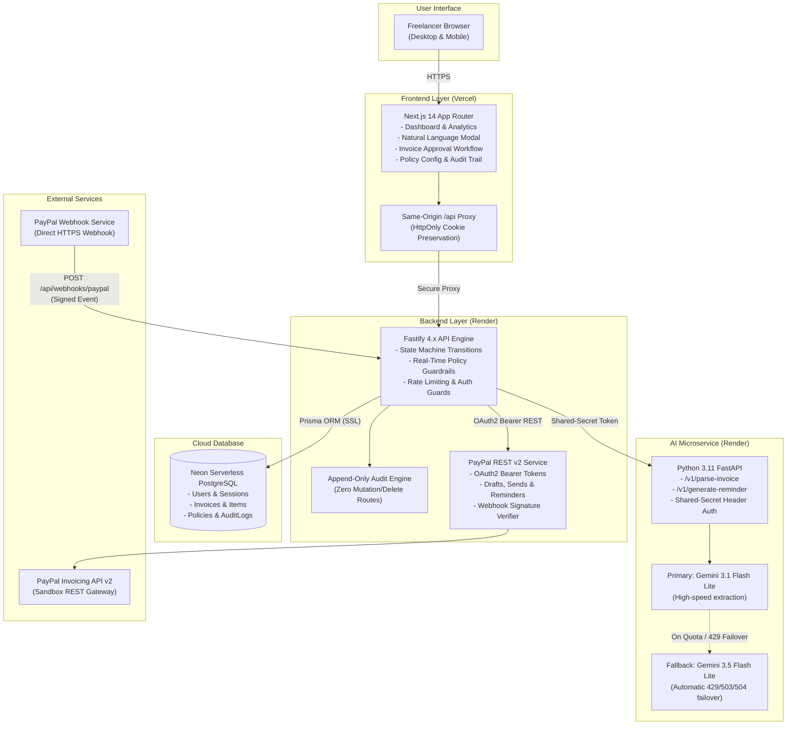

# 🧭 FinPilot

> **Autonomous AI-Assisted, Policy-Governed PayPal Invoicing Platform for Freelancers**

[](https://frontend-nu-indol-56.vercel.app)
[](https://finpilot-backend-a3lw.onrender.com/health)
[](https://finpilot-ai-d3qf.onrender.com/health)
[](https://neon.tech)
[](https://developer.paypal.com)
[](./LICENSE)

---

## ⚡ Quick Demo & Live Deployment Links

| Resource | URL | Status |
|:---|:---|:---:|
| **Live Web App (Frontend)** | [https://frontend-nu-indol-56.vercel.app](https://frontend-nu-indol-56.vercel.app) | 🟢 **Active (Vercel)** |
| **Backend API Server** | [https://finpilot-backend-a3lw.onrender.com](https://finpilot-backend-a3lw.onrender.com) | 🟢 **Active (Render)** |
| **Backend Health Check** | [https://finpilot-backend-a3lw.onrender.com/health](https://finpilot-backend-a3lw.onrender.com/health) | 🟢 `200 OK` |
| **Python AI Microservice** | [https://finpilot-ai-d3qf.onrender.com](https://finpilot-ai-d3qf.onrender.com) | 🟢 **Active (Render)** |
| **AI Service Health Check** | [https://finpilot-ai-d3qf.onrender.com/health](https://finpilot-ai-d3qf.onrender.com/health) | 🟢 `200 OK` |
| **Registered PayPal Webhook** | `https://finpilot-backend-a3lw.onrender.com/api/webhooks/paypal` | 🟢 **Subscribed** |

### 🔑 Demo Account Credentials

Use these credentials to log in instantly or click the one-click **"Auto-fill"** button on the login screen:

```yaml
URL:      https://frontend-nu-indol-56.vercel.app/login
Email:    demo@finpilot.dev
Password: finpilot123
```


## 📖 Executive Summary

Independent freelancers spend hours each month manually typing invoices, calculating due dates, tracking payments, chasing overdue balances, and dreading awkward payment reminder conversations. At the same time, giving an AI direct access to financial actions without boundaries is dangerous: an unconstrained LLM can draft incorrect billing amounts, email clients without authorization, or misinterpret payment webhooks.

**FinPilot solves both problems.** It provides an intelligent, human-in-the-loop autonomous billing assistant built with strict policy safeguards:

1. **Natural Language to Structured Invoice**: A freelancer types a plain-text prompt (e.g. *"Bill NexaTech (payables@nexatech.io) $2,250 for React Native & FastAPI mobile architecture (30 hrs @ $75/hr), due next Friday"*). Google Gemini parses the request into structured line items, currency, client metadata, and dates.
2. **Explicit Human-in-the-Loop Approval**: The AI can *only* create drafts in `PROPOSED` status. Nothing is ever sent to PayPal or emailed to a client without an explicit review and human approval in the UI.
3. **Real-Time Policy Guardrails**: Automatic policy evaluation warns or blocks high-value ceilings (e.g. `>$10,000`), detects accidental duplicate invoices within a 24-hour sliding window, and regulates dunning frequency.
4. **Official PayPal Invoicing REST API v2**: Generates legitimate PayPal Sandbox invoices, dispatches them directly to client inboxes with PayPal payer links, and manages dunning reminders.
5. **Cryptographic Webhook Security with Mandatory Re-Fetch**: Validates incoming `INVOICING.INVOICE.PAID` asymmetric signatures, and **never trusts the webhook body alone**—it independently re-fetches the live invoice from PayPal to confirm full `$0.00` settlement before updating local records.
6. **Immutable Append-Only Audit Trail**: Every action, actor attribution, policy override, and webhook event is recorded permanently with zero deletion or mutation routes.

---

## 🏗️ System Architecture & Data Flow



---

## ⚙️ Tech Stack & Key Components

| Layer | Technology | Operational Function |
|:---|:---|:---|
| **Frontend Portal** | **Next.js 14 (App Router), TypeScript, Tailwind CSS, Lucide** | Responsive billing workspace, conversational invoice modal, same-origin API proxy, live policy feedback. |
| **Backend API** | **Node.js 20+, Fastify 4.x, TypeScript** | Deterministic state machine, financial policy engine, PayPal client, origin-restricted CORS, rate limiter. |
| **Database & ORM** | **Neon Serverless PostgreSQL, Prisma ORM 5.x** | ACID transactions, SSL pooling, relational integrity, immutable append-only audit trail. |
| **AI Microservice** | **Python 3.11+, FastAPI, Uvicorn, Google GenAI SDK** | Natural language invoice extraction, currency detection, contextual dunning reminder drafting. |
| **LLM Models** | **Google Gemini 3.1 Flash Lite (Primary) & Gemini 3.5 Flash Lite (Fallback)** | Dual-model fallback architecture with bounded single-pass retry for HTTP 429, 503, and 504 errors. |
| **Payment Gateway** | **PayPal Invoicing REST API v2 (Sandbox)** | Official draft creation, recipient email dispatch, reminder notifications, and webhook settlements. |
| **Security & Auth** | **Signed HttpOnly Cookies, bcrypt, HMAC SHA-256** | Secure session management, CSRF protection, and asymmetric webhook signature verification. |

---

## 🛡️ Enterprise Financial Safeguards & Policies

### 1. Human-in-the-Loop State Machine
FinPilot enforces an unbypassable 5-stage deterministic lifecycle:
```
[PROPOSED] ──(Explicit User Approval)──> [APPROVED] ──(Create Draft)──> [CREATED] ──(Send to Client)──> [SENT] ──(Verified Webhook)──> [PAID]
                                                                                                            └──(Overdue Check)──> [OVERDUE] ──(Settlement)──> [PAID]
```
- **Zero Autonomous Dispatch**: The AI service produces only `PROPOSED` invoice drafts. It is mathematically impossible for an invoice to be sent to PayPal or emailed to a client without explicit user authorization in the UI.
- **Terminal Settlement**: Once transitioned to `PAID`, an invoice cannot be modified, re-sent, or reminded.

### 2. Policy Engine Guardrails
Every invoice proposal and reminder undergoes real-time evaluation before approval:
- **Maximum Amount Limit**: Defaults to `$10,000.00 USD`. Invoices exceeding this ceiling trigger an alert and require an explicit policy override acknowledgment before approval.
- **24-Hour Duplicate Window**: Flags any invoice created with the same client email and identical total amount within a 24-hour sliding window, preventing accidental double-billing.
- **Dunning Safeguards**: Reminders are barred unless an invoice is strictly `SENT` or `OVERDUE`. The policy engine enforces a maximum of 3 reminders per invoice and a mandatory **3-day cooling-off period** between consecutive reminders.

### 3. Cryptographic Webhook Security with Mandatory Re-Fetch
- FinPilot verifies incoming PayPal webhook signatures against PayPal's verification service (`/v1/notifications/verify-webhook-signature`) checking `paypal-auth-algo`, `paypal-cert-url`, `paypal-transmission-id`, `paypal-transmission-sig`, and `paypal-transmission-time`.
- **Zero-Trust Webhook Body**: FinPilot **never trusts the incoming webhook payload alone**. Upon receiving `INVOICING.INVOICE.PAID`, the backend makes an out-of-band server-to-server call (`GET /v2/invoicing/invoices/{id}`) directly to PayPal to verify:
  1. `verifiedStatus === 'PAID'`
  2. `due_amount === 0.00`
  3. `paid_amount >= expectedTotal - 0.01`
- Partial payments or pending authorizations are recorded in the audit trail without prematurely marking the invoice as paid.

### 4. Immutable Append-Only Audit Trail
- Every proposal generation, edit, approval, policy override, reminder dispatch, and payment event records an immutable `AuditLog` entry with timestamp, actor attribution, and JSON context snapshot.
- Zero update, edit, or delete endpoints exist in the application for audit records.

---

## 📸 Project Media Gallery

FinPilot features a complete visual design with clean data density and glassmorphism UI:

| Screen | Preview | Highlights |
|:---|:---|:---|
| **01. Login Portal** | Secure authentication with signed cookies and one-click demo credentials. |
| **02. Executive Dashboard** | Real-time cashflow metrics, lifecycle breakdown, and recent invoices. |
| **03. AI Prompt Modal** | Natural language invoice generator with quick-start templates. |
| **04. Invoice Detail & PayPal Lifecycle** | State machine controls, PayPal draft creation, and dunning controls. |
| **05. Policy Guardrails Engine** | Live rule configuration for maximum ceilings, duplicate windows, and reminder limits. |
| **06. Immutable Audit Trail** | Append-only event log with actor tracking, timestamps, and JSON snapshots. |

*Full high-resolution project media captures are stored in [`project_media/`](./project_media).*

---

## 🎮 How to Demo FinPilot (Step-by-Step Walkthrough)

### Step 1: Sign In
1. Visit **[https://frontend-nu-indol-56.vercel.app/login](https://frontend-nu-indol-56.vercel.app/login)**.
2. Click the **"Auto-fill"** button in the Demo Credentials banner:
   - **Email**: `demo@finpilot.dev`
   - **Password**: `finpilot123`
3. Click **"Sign in"** to enter the workspace.

### Step 2: Create an Invoice with Natural Language
1. Click **"Create Invoice with AI"** in the top navigation bar.
2. Enter or choose a sample prompt:
   ```text
   Bill NexaTech (payables@nexatech.io) $2,250 for React Native & FastAPI mobile architecture (30 hrs @ $75/hr), due next Friday.
   ```
3. Click **"Generate Proposal"**. 
4. Gemini extracts the structured invoice (client name, email, hours, hourly rate, calculated total, and due date).

### Step 3: Review & Explicit Approval
1. Review the proposed invoice details on the invoice view page.
2. Notice the status is `PROPOSED`.
3. Click **"Approve Invoice Proposal"** to satisfy the human-in-the-loop requirement. The status advances to `APPROVED`.

### Step 4: Create PayPal Draft & Send
1. Click **"Create PayPal Invoice Draft"**. The backend invokes PayPal's `/v2/invoicing/invoices` API and assigns an official PayPal Invoice ID (`INV2-...`).
2. Click **"Send to Client via PayPal"**. The invoice is officially dispatched through PayPal's sandbox servers. Status advances to `SENT`.

### Step 5: Send an AI Dunning Reminder
1. On the sent invoice, click **"Send AI Reminder"**.
2. Select your desired tone: **Gentle**, **Firm**, or **Urgent**.
3. Gemini generates personalized dunning copy with all invoice details and the requested tone.
4. Click **"Dispatch Reminder"** — the reminder count increments to `1/3` and the 3-day cooldown activates.

### Step 6: Verify Immutable Audit Trail
1. Click **"Audit Trail"** in the top navigation.
2. Observe every action: proposal creation, policy checks, approval, PayPal draft generation, email dispatch, and reminder generation.

---

## 🧪 Comprehensive Automated Test Suites

FinPilot includes complete end-to-end and regression test coverage:

### 1. Gemini Dual-Model Fallback Unit Tests (10/10 Passed)
```bash
cd ai-service-python
python -m pytest tests/test_fallback.py -v
```
- Validates primary success, HTTP 429 quota exhaustion fallback, HTTP 503/504 gateway failover, immediate failure on auth/permission errors (401/403/400), dual-model failure reporting, and bounded retry prevention.

### 2. Python AI Extraction Evaluation Suite (18/18 Cases, 100% Pass)
```bash
cd ai-service-python
python evals/run_eval.py
```
- Validates multi-currency detection (`USD`, `EUR`, `GBP`, `INR`), Hinglish parsing, prompt injection defense, missing attributes, and rate-limit buffering.

### 3. Security & Failure-Path Tests (57 Automated Checks)
```bash
cd backend
npx tsx test-failure-paths.ts
```
- Asserts state machine integrity, forged signature rejection, duplicate window enforcement, rate limits, CORS origin isolation, and schema validation.

### 4. Audit Log Immutability Verification (10 Checks)
```bash
cd backend
npx tsx test-audit-immutability.ts
```
- Validates zero mutation or deletion routes across the Fastify API.

---

## 🚀 Local Development Setup

### Prerequisites
- **Node.js**: v20+ recommended
- **Python**: v3.11+
- **npm**: v9+

### Quickstart

1. **Clone repository & install dependencies**:
   ```bash
   git clone https://github.com/ShivamMungbhate/FinPilot.git
   cd FinPilot
   npm run install:all
   python -m pip install -r ai-service-python/requirements.txt
   ```

2. **Configure environment files**:
   ```bash
   cp .env.example .env
   cp backend/.env.example backend/.env
   cp frontend/.env.example frontend/.env
   cp ai-service-python/.env.example ai-service-python/.env
   ```
   Add your `GEMINI_API_KEY` into `ai-service-python/.env`.

3. **Initialize database & seed demo records**:
   ```bash
   npm run reset
   ```

4. **Start all services concurrently**:
   ```bash
   npm run dev
   ```
   - **Frontend**: [http://localhost:3000](http://localhost:3000)
   - **Backend API**: [http://localhost:4000](http://localhost:4000)
   - **Python AI**: [http://localhost:5002](http://localhost:5002)

---

## 📋 Environment Configuration Reference

| Variable | Target Service | Type | Purpose |
|:---|:---|:---:|:---|
| `NEXT_PUBLIC_API_URL` | Frontend | Build-time | Base API URL for browser requests. |
| `BACKEND_INTERNAL_URL` | Frontend | Build & Runtime | Proxy destination for Next.js same-origin `/api` rewrites. |
| `DATABASE_URL` | Backend | Runtime | PostgreSQL connection string (Neon Serverless with SSL). |
| `SESSION_SECRET` | Backend | Runtime | Minimum 32-character HMAC secret for signed session cookies. |
| `FRONTEND_URL` | Backend | Runtime | Whitelisted origin for strict CORS credentials verification. |
| `AI_SERVICE_URL` | Backend | Runtime | Target URL of the Python AI microservice. |
| `AI_SERVICE_TOKEN` | Backend & AI Service | Runtime | Shared-secret bearer token protecting public AI endpoints. |
| `SHOW_DEMO_LOGIN` | Backend | Runtime | Toggles demo credential helpers on the login page (`true`/`false`). |
| `ENABLE_PAYMENT_SIMULATION` | Backend | Runtime | Disables developer simulation endpoints on public deployments (`false`). |
| `PAYPAL_ENV` | Backend | Runtime | Target PayPal environment (`sandbox` or `live`). |
| `PAYPAL_CLIENT_ID` | Backend | Runtime | PayPal Developer Sandbox Client ID. |
| `PAYPAL_CLIENT_SECRET` | Backend | Runtime | PayPal Developer Sandbox Secret. |
| `PAYPAL_WEBHOOK_ID` | Backend | Runtime | PayPal registered webhook ID for cryptographic validation. |
| `GEMINI_API_KEY` | AI Service | Runtime | Google AI Studio API Key. |
| `GEMINI_MODEL` | AI Service | Runtime | Primary model identifier (`gemini-3.1-flash-lite`). |
| `GEMINI_FALLBACK_MODEL` | AI Service | Runtime | Fallback model identifier on 429/503/504 (`gemini-3.5-flash-lite`). |

---

## 📄 License

Distributed under the **MIT License**. See [LICENSE](./LICENSE) for full details.
